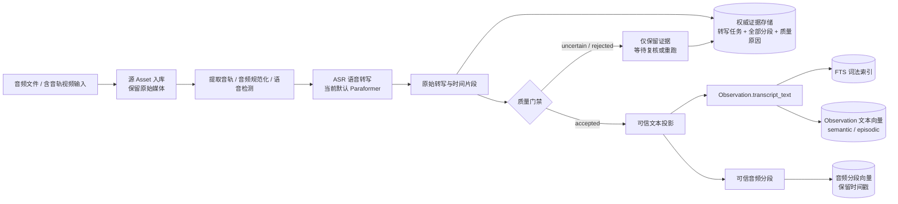

# 音频 ASR 模型总指标与存储链路

## 目录

- [1. 一句话结论](#1-一句话结论)
- [2. 评测口径](#2-评测口径)
- [3. 五模型总指标表](#3-五模型总指标表)
- [4. 指标解读](#4-指标解读)
- [5. 音频输入到存储的整体链路](#5-音频输入到存储的整体链路)
- [6. 当前实现边界](#6-当前实现边界)
- [7. 代码与结果来源](#7-代码与结果来源)
- [8. 术语](#8-术语)

## 1. 一句话结论

在这组 AliMeeting 样本上，**Fun-ASR-Nano-2512 的 CER 最低，Qwen3-ASR-0.6B 次之**；两者都显著改善远场识别。若优先控制显存和延迟，Qwen3-ASR 更均衡；若优先准确率，Fun-ASR-Nano 更好。

- **Fun-ASR-Nano-2512**：准确率最佳，但 MPS FP32 约占 3.18 GB 模型内存，且 FP16/MPS 会产生异常输出。
- **Qwen3-ASR-0.6B**：准确率接近最优、速度更快、MPS FP16 约占 1.50 GB，是更均衡的新候选。
- **Paraformer**：模型更小、已有 VAD/标点/时间片段链路，仍是当前生产默认模型。
- **SenseVoiceSmall**：速度最佳，但准确率略低，可作为低延迟候选。
- **Whisper small 4-bit**：模型文件最小，速度尚可，但中文会议识别和门禁后文本质量明显落后，不建议进入当前生产链路。

## 2. 评测口径

| 项目 | 设置 |
|---|---|
| 数据集 | AliMeeting Eval |
| 近讲组 | 100 条，458.71 秒，同一组耳麦近讲片段 |
| 远讲组 | 100 条，477.87 秒，同一组阵列远讲、无多人重叠片段 |
| 总音频 | 200 条，936.58 秒 |
| 评测设备 | Apple Silicon；Paraformer、SenseVoice、Qwen3-ASR、Fun-ASR-Nano 使用 MPS，Whisper 使用 MLX |
| CER | 去除空格、标点、控制标签后计算中文字符错误率，越低越好 |
| 污染样本 | CER > 20% 且仍被质量门禁放入检索的样本 |
| 存储验证 | 独立 SQLite：转写表、分段表、FTS5 检索文本 |
| 执行方式 | 模型常驻、单样本串行、预热 1 条 |

Paraformer 与 SenseVoiceSmall 使用相同的 FSMN-VAD。Whisper 使用自身的 `no_speech_prob`。Qwen3-ASR 与 Fun-ASR-Nano 此次直接识别数据集中已切好的语音片段，不额外运行 VAD；两者以及 Whisper 都在 CER、门禁和入库前做繁体转简体。各行反映对应后端实际可用的端到端处理方式，因此预处理并非完全相同。

## 3. 五模型总指标表

> 每组均为 100 条音频。加粗表示同一数据集下的相对最佳结果。平均耗时为 ASR 与门禁的总推理时间除以 100，不包含模型加载和存储。内存使用各运行时能够提供的原生指标，PyTorch MPS 与 MLX 口径不同，不能简单横向比较。

| 模型 | 数据集 | 模型大小 | CER ↓ | 门禁后 CER ↓ | 可检索率 ↑ | 污染率 ↓ | 单条平均推理耗时 ↓ | RTF ↓ | 内存观测 |
|---|---|---:|---:|---:|---:|---:|---:|---:|---|
| **Fun-ASR-Nano-2512** | 近讲 | 约 1.6 GB | **4.55%** | **4.55%** | **100%** | **4.00%** | 0.488 s | 0.1064 | RSS 664 MB；MPS allocated 3185 MB；driver 3742 MB |
| **Paraformer** | 近讲 | 约 953 MB | 4.68% | 4.68% | **100%** | 6.00% | 0.246 s | 0.0536 | RSS 961 MB；Metal driver 1779 MB |
| **Qwen3-ASR-0.6B** | 近讲 | 约 1.5 GB | 5.21% | 5.21% | **100%** | 10.00% | 0.303 s | 0.0661 | RSS 690 MB；MPS allocated 1501 MB；driver 2688 MB |
| **SenseVoiceSmall** | 近讲 | 约 901 MB | 5.79% | 5.79% | **100%** | **6.00%** | **0.142 s** | **0.0311** | RSS 885 MB；Metal driver 1951 MB |
| **Whisper small 4-bit** | 近讲 | **196.5 MB** | 19.97% | 18.78% | 94% | 40.43% | 0.157 s | 0.0343 | RSS 538 MB；MLX 内部峰值 981 MB |
| **Fun-ASR-Nano-2512** | 远讲无重叠 | 约 1.6 GB | **7.37%** | **7.37%** | **100%** | **16.00%** | 0.470 s | 0.0984 | RSS 759 MB；MPS allocated 3185 MB；driver 3742 MB |
| **Qwen3-ASR-0.6B** | 远讲无重叠 | 约 1.5 GB | 8.99% | 8.99% | **100%** | 21.00% | 0.285 s | 0.0596 | RSS 623 MB；MPS allocated 1501 MB；driver 2664 MB |
| **Paraformer** | 远讲无重叠 | 约 953 MB | 15.42% | 13.34% | 95% | 25.26% | 0.197 s | 0.0413 | RSS 1054 MB；Metal driver 1788 MB |
| **SenseVoiceSmall** | 远讲无重叠 | 约 901 MB | 16.27% | 14.22% | **95%** | 26.32% | **0.147 s** | **0.0307** | RSS 865 MB；Metal driver 1960 MB |
| **Whisper small 4-bit** | 远讲无重叠 | **196.5 MB** | 30.75% | 24.39% | 73% | 46.58% | 0.162 s | 0.0339 | RSS 573 MB；MLX 内部峰值 981 MB |

### FP16 Whisper 复核

FP16 Whisper small 只在相同的 5 条近讲样本上做了复核，没有混入上面的 100 条正式横向表。它与 4-bit 版本的 Corpus CER 都是 18.35%，但模型增至 481.3 MB，RTF 从 0.0339 上升到 0.0412，MLX active 从约 195 MB 上升到约 462 MB。因此完整 200 条评测保留 4-bit 版本即可；当前主要问题不是量化精度损失。

## 4. 指标解读

### 4.1 准确率

Fun-ASR-Nano 在两组数据上的 Corpus CER 都最低，尤其将远场 CER 降至 7.37%；Qwen3-ASR 的远场 CER 为 8.99%，同样明显优于旧三模型。近讲数据上五者前三名差距较小，需要用真实家庭录音复核泛化能力。

### 4.2 速度

SenseVoiceSmall 的端到端 RTF 最低。新模型中 Qwen3-ASR 比 Fun-ASR-Nano 快约 38%～40%，并且显存占用约为后者一半；Fun-ASR-Nano 的准确率优势需要用更高资源换取。

### 4.3 质量门禁

Paraformer、SenseVoiceSmall、Qwen3-ASR 和 Fun-ASR-Nano 当前适配层都没有返回可直接使用的声学置信度，因此结构正常的句子大多会被放行，门禁后 CER 几乎不变。Whisper 能提供平均 token 概率和无语音概率，但已放行文本的污染率仍偏高。Fun-ASR-Nano 在 MPS FP16 下曾输出纯标点，现有结构门禁成功将 5/5 异常样本全部拒绝，说明它能挡住格式崩坏，但仍挡不住语义通顺的错字。

### 4.4 存储

十次正式运行全部 100/100 写入成功，完整性匹配率均为 100%。两个新模型单批 100 条的存储耗时为 0.016～0.028 秒，与 ASR 推理相比可以忽略。模型差异主要影响识别质量和推理资源，不影响统一存储结构。

## 5. 音频输入到存储的整体链路

这条链路遵循两个核心原则：

1. **原始转写是证据，可信文本是投影。** 原始结果、可疑结果和失败原因都保存，但不会自动进入主检索索引。
2. **模型可替换，存储结构不分叉。** 不论使用 Paraformer、SenseVoice 还是 Whisper，最终都转换为统一的转写任务、分段和 `accepted_text`，不为每个模型单独建立数据库通路。

## 6. 当前实现边界

- 生产代码当前通过 FunASR sidecar 使用 Paraformer；SenseVoiceSmall、Whisper small、Qwen3-ASR 和 Fun-ASR-Nano 仍只是独立评测候选，没有切换生产默认模型。
- 已实现原始转写、分段、时间戳、质量状态、质量原因、可信文本投影、FTS 和文本向量索引。
- 视频音轨已接入同一条 ASR 链；证据与向量使用源视频 `asset_id`，检索结果可直接返回视频及命中时间戳。
- `uncertain` / `rejected` 文本保存在权威转写表中，但不进入主索引。
- 当前没有 Qwen 摘要、情绪识别、说话人识别、说话人分离和独立音频向量模型。
- 当前 Paraformer 缺少声学置信度，仍难以识别“句子通顺但关键词听错”的问题；需要使用真实家庭录音继续校准门禁。
- 当前 Qwen3-ASR/Fun-ASR-Nano 的 Hugging Face 生成式权重只保存整段起止时间，不提供真实词级时间戳；视频对齐需要额外的 forced aligner，或改用提供时间戳的原生 FunASR 路径。
- Fun-ASR-Nano 在本机 MPS 上必须使用 FP32；FP16 实测出现重复感叹号。Qwen3-ASR 可稳定使用 FP16。
- 独立 `audio_eval` 评测不会启动前端、Agent 或主项目向量模型；它验证 ASR、门禁、SQLite 和 FTS 存储形状。生产流程图则反映主项目已接入的完整存储与索引方向。

## 7. 代码与结果来源

### 生产链路

- 音频转写编排：[`transcribe_audio.py`](../../apps/api/src/sentrix/application/media/transcribe_audio.py)
- 领域模型与质量门禁：[`transcription.py`](../../apps/api/src/sentrix/domain/media/transcription.py)
- 权威转写仓储：[`audio_transcriptions.py`](../../apps/api/src/sentrix/infrastructure/persistence/repositories/audio_transcriptions.py)
- 数据库迁移：[`0015_audio_transcriptions.sql`](../../apps/api/src/sentrix/infrastructure/persistence/migrations/0015_audio_transcriptions.sql)
- Observation 文本向量：[`index_observation_text.py`](../../apps/api/src/sentrix/application/retrieval/index_observation_text.py)
- 音频分段向量：[`index_audio_transcript.py`](../../apps/api/src/sentrix/application/retrieval/index_audio_transcript.py)
- 详细质量门禁设计：[`audio-understanding-quality-gate.md`](audio-understanding-quality-gate.md)

### 评测结果

- 三模型摘要：[`asr-model-comparison.md`](../../audio_eval/outputs/asr-model-comparison.md)
- Whisper 专项：[`whisper-small-comparison.md`](../../audio_eval/outputs/whisper-small-comparison.md)
- Paraformer 近讲：[`report.md`](../../audio_eval/outputs/alimeeting-near-100-mps-asr-vad-storage/report.md)
- Paraformer 远讲：[`report.md`](../../audio_eval/outputs/alimeeting-far-nonoverlap-100-mps-asr-vad-storage/report.md)
- SenseVoiceSmall 近讲：[`report.md`](../../audio_eval/outputs/alimeeting-near-100-sensevoice-mps-asr-vad-storage/report.md)
- SenseVoiceSmall 远讲：[`report.md`](../../audio_eval/outputs/alimeeting-far-nonoverlap-100-sensevoice-mps-asr-vad-storage/report.md)
- Whisper 近讲：[`report.md`](../../audio_eval/outputs/alimeeting-near-100-whisper-small-4bit-mlx-storage/report.md)
- Whisper 远讲：[`report.md`](../../audio_eval/outputs/alimeeting-far-nonoverlap-100-whisper-small-4bit-mlx-storage/report.md)
- Qwen3-ASR 近讲：[`report.md`](../../audio_eval/outputs/alimeeting-near-100-qwen3-asr-0.6b-mps-fp16-storage/report.md)
- Qwen3-ASR 远讲：[`report.md`](../../audio_eval/outputs/alimeeting-far-nonoverlap-100-qwen3-asr-0.6b-mps-fp16-storage/report.md)
- Fun-ASR-Nano 近讲：[`report.md`](../../audio_eval/outputs/alimeeting-near-100-fun-asr-nano-2512-mps-fp32-storage/report.md)
- Fun-ASR-Nano 远讲：[`report.md`](../../audio_eval/outputs/alimeeting-far-nonoverlap-100-fun-asr-nano-2512-mps-fp32-storage/report.md)

## 8. 术语

| 术语 | 含义 |
|---|---|
| ASR | Automatic Speech Recognition，自动语音识别 |
| VAD | Voice Activity Detection，语音活动检测 |
| CER | 字符错误率；错误字符数除以人工转写字符数，越低越好 |
| RTF | 实时率；推理时间除以音频时长，低于 1 表示快于实时播放 |
| 可检索率 | 至少有一段文本通过门禁并进入检索投影的样本比例 |
| 检索文本 CER | 仅统计门禁放行、实际会进入检索的文本错误率 |
| 污染率 | 已进入检索的样本中，CER 大于 20% 的比例 |
| 错误样本误放行率 | CER 大于 20% 的错误样本中，仍被门禁放行的比例 |
| 权威证据 | 可追溯的原始转写、分段、模型配置和质量判断结果 |
| 检索投影 | 从权威证据生成、可删除重建的 FTS 或向量索引 |
