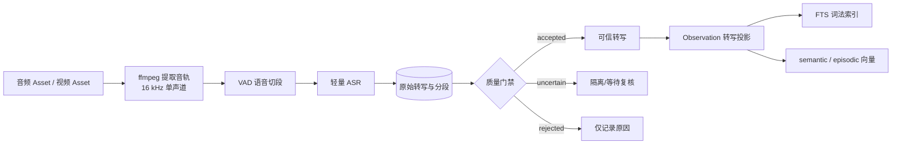

# 音频理解与转写质量门禁设计

## 目录

- [1. 目标](#1-目标)
- [2. 核心原则](#2-核心原则)
- [3. 处理链路](#3-处理链路)
- [4. 存储设计](#4-存储设计)
- [5. 质量门禁](#5-质量门禁)
- [6. 检索接入](#6-检索接入)
- [7. 性能与资源控制](#7-性能与资源控制)
- [8. 第一版范围](#8-第一版范围)
- [9. 验证与本地运行](#9-验证与本地运行)

## 1. 目标

在现有音频“文件入库 + ffprobe 元数据”和视频导入能力之上，增加：

1. 音频语音转写；
2. 转写质量判断；
3. 可信文本的 FTS 与向量检索；
4. 原始结果可追溯、可重跑、可人工修正；
5. 控制模型大小、运行时间和资源占用。

改造前的音频能力只包含文件入库与 ffprobe 元数据，视频也只处理画面。第一版现已在
[`import_assets.py`](../../apps/api/src/sentrix/application/media/import_assets.py) 的导入编排上接入
独立 ASR 用例，并加入专用转写表与 `Observation.transcript_text` 可信投影。音频文件与视频
音轨共用同一条链：sidecar 用 ffmpeg 的 `-vn` 从媒体中提取默认音轨，转写证据直接绑定
源 Asset；视频检索命中因此直接返回源视频和音轨时间戳，不创建需要二次映射的音频子资产。

## 2. 核心原则

- **原始转写不等于可信记忆**：ASR 原文始终保存，但不能自动获得进入主索引的资格。
- **原始数据与检索投影分离**：ASR 表保存证据，Observation/FTS/向量只是可重建投影。
- **按片段判断质量**：一段录音中某些句子清晰、某些句子含糊，不能整段共用一个分数。
- **宁可少收录，不要误污染**：主索引优先保证精度，可疑文本进入隔离区。
- **不使用文本通顺度证明正确性**：ASR 可能生成通顺但与原音频不一致的句子。
- **所有结论带来源**：保存模型、版本、参数、时间戳、质量原因和修订关系。

## 3. 处理链路



第一版沿用项目现有的同步 `prepare → commit` 导入链，不另造一个没有任务状态与消费者的后台队列。
ASR 模型在独立 sidecar 中常驻，API 客户端用单并发闸门限制资源占用。整册导入的模型准备阶段
仍可并行处理其他媒体，但一条音频或含音轨视频的导入会等待本次 ASR 完成；真正的持久化任务队列留到项目统一
引入 job 基础设施时再做。

## 4. 存储设计

### 4.1 `audio_transcriptions`

记录一段音频的一次识别任务：

| 字段 | 含义 |
|---|---|
| `asset_id` / `scope_id` | 所属音频或源视频与记忆空间 |
| `status` | queued / running / completed / review / failed |
| `model_name` / `model_version` | 模型来源 |
| `config_hash` | VAD、语言、阈值等配置指纹 |
| `language` | 识别语言 |
| `raw_text` | 当前模型/配置修订的原始输出，不进入主索引 |
| `accepted_text` | 仅拼接通过门禁的片段 |
| `quality_score` | 校准后的总体质量，仅供排序和诊断 |
| `error_message` | 失败原因 |

当前幂等键使用 `asset_id + model_name + model_version + config_hash`。同一配置重跑更新同一修订；
换模型、模型版本、参数或门禁版本时创建新修订，旧修订仍保留。

### 4.2 `audio_transcript_segments`

| 字段 | 含义 |
|---|---|
| `start_ms` / `end_ms` | 音频时间位置 |
| `raw_text` | 片段原始转写 |
| `normalized_text` | 确定性标点、数字等规范化结果 |
| `confidence_raw` | 模型原始分数，可为空 |
| `confidence_calibrated` | 用本项目验证集校准后的分数 |
| `alignment_score` | 文字与音频对齐程度 |
| `quality_status` | accepted / uncertain / rejected / human_corrected |
| `quality_reasons_json` | 未通过门禁的具体原因 |
| `searchable` | 是否允许进入主索引 |

人工修正写入新值并标记 `human_corrected`，同时保留原始 ASR 文本。

## 5. 质量门禁

门禁采用“硬规则 + 校准分数”，不依赖单一 confidence。

### 5.1 技术与 VAD 门禁

- 无法解码或没有音轨：`rejected`；
- VAD 未检测到人声：`no_speech`，不转写；
- 片段过短、音量过低、严重削波或主要为噪声：`uncertain/rejected`；
- 长音频先切为约 15～30 秒片段，静音部分不送入 ASR。

### 5.2 声学门禁

综合以下信号：

- ASR 原始置信度或路径分数；
- token/字符时间戳覆盖率；
- 文字与音频的强制对齐分数；
- 人声概率、语言概率和有效语音覆盖率；
- 是否存在多人重叠、强噪声或背景音乐。

声学证据不足时，即使句子语法通顺，也不能直接进入主索引。

### 5.3 文本异常门禁

检查：

- 连续重复词或重复 n-gram；
- 文本长度与语音时长严重不匹配；
- 大量乱码、异常字符或只有标点；
- 检测语言与预期语言不一致；
- 明显不完整或不通顺的文本。

文本通顺度只能作为弱信号，不能发现“通顺但识别错误”的幻觉。

### 5.4 三档结果

| 状态 | 处理 |
|---|---|
| `accepted` | 进入 Observation、FTS 和文本向量 |
| `uncertain` | 原文保留，不进入主索引；可二次识别或人工复核 |
| `rejected` | 只保存失败原因，不建立文本索引 |
| `human_corrected` | 最高可信，替换检索投影并重建索引 |

阈值必须用真实家庭录音校准，不能直接规定“confidence ≥ 0.8”。重点指标包括字符错误率、
人名/地名错误率、静音幻觉率和误放行率。

## 6. 检索接入

建议给 Observation 增加 `transcript_text` 和可选的 `audio_description`：

- `transcript_text`：只包含通过门禁的片段；
- `audio_description`：可选的派生摘要，不作为原始证据；
- 原始和分段转写仍以 ASR 表为权威来源。

可信片段可以单独写向量：

```text
space       = semantic
source_type = audio_segment
source_id   = segment_id
metadata    = {asset_id, start_ms, end_ms, confidence}
```

检索后按 `asset_id` 聚合，并保留命中时间戳。现有 Observation 文本拼接逻辑位于
[`index_observation_text.py`](../../apps/api/src/sentrix/application/retrieval/index_observation_text.py)。

## 7. 性能与资源控制

- ASR 作为独立 sidecar/worker，不加载进 API 进程；
- 默认并发数为 1，并设置队列和背压；
- 模型常驻，避免每段音频重复加载；
- VAD 先过滤静音，分段后逐段处理并支持断点续跑；
- 第一版只跑一个主模型；二次识别可在真实数据证明有收益后再加；
- 第一批候选可测试 SenseVoiceSmall 与 Paraformer-zh；低配环境可提供量化 Whisper 作为降级方案；
- 使用真实数据比较 CER、人名召回、RTF、峰值内存和模型体积后再确定模型。

## 8. 第一版范围

第一版已实现：

1. 音频文件或视频音轨的提取、规范化和 VAD；
2. 一种 ASR 模型；
3. 原始转写、分段和时间戳存储；
4. accepted / uncertain / rejected 门禁；
5. 可信片段进入 FTS 和现有文本向量空间；
6. 检索结果保留音频时间位置；
7. 模型或配置变化后可重跑、重建索引。

导入接口通过 `audio_transcription_status` 返回 `completed`、`review` 或 `failed`；ASR 失败
不会回滚已经入库的音频或视频资产，但也不会伪装成一次完整成功。

实现落点：

- 领域模型与门禁：`domain/media/transcription.py`；
- ASR 客户端：`infrastructure/media/asr_sidecar.py`；
- FunASR 独立进程：`scripts/maintenance/funasr_sidecar.py`；
- 权威仓储：`infrastructure/persistence/repositories/audio_transcriptions.py`；
- 导入编排：`application/media/transcribe_audio.py`；
- 分段向量：`application/retrieval/index_audio_transcript.py`；
- 数据库迁移：`0015_audio_transcriptions.sql`（`0014` 已由上游记忆图迁移占用）。

第一版明确不实现 Qwen 摘要、情绪识别和说话人识别。`confidence_calibrated` 与总体
`quality_score` 在建立真实家庭录音验证集前保持空值，不把模型原始分数冒充校准分数。

当前 Paraformer 输出如果没有置信度/对齐分数，第一版会依靠时长、字符率、乱码与重复等
结构规则放行，同时给该片段记录 `no_acoustic_score`。这能维持检索可用性，但还不能可靠拦住
“句子通顺、实际听错”的情况；在完成真实录音验证和分数校准前，这属于已知限制。

第一版暂不实现说话人分离、声纹身份、LLM 自动纠错、LLM 摘要和独立音频向量模型。

## 9. 验证与本地运行

### 9.1 只验证检索链路

不启动前端、HTTP API 或真实模型，直接用假 ASR 输出验证门禁、SQLite 存储、词法索引、
文本向量与带时间戳召回：

```bash
.venv/bin/pytest \
  apps/api/tests/contract/test_audio_routes.py \
  apps/api/tests/integration/test_audio_retrieval_pipeline.py \
  apps/api/tests/integration/test_audio_transcriptions.py \
  apps/api/tests/unit/test_audio_quality.py \
  -q
```

该测试同时覆盖三条路径：音频与视频音轨的高置信片段能从 FTS 和文本向量搜回源 Asset
及毫秒时间戳；视频转写证据直接关联源视频；低置信片段保留在权威转写表中，但不会写入
两类检索索引。

### 9.2 接入真实 FunASR

前置条件：主 API 已按项目 README 安装，机器上可执行 `ffmpeg`。ASR 使用单独虚拟环境：

```bash
python3.11 -m venv .venv-asr
.venv-asr/bin/pip install -r scripts/maintenance/funasr-requirements.txt
.venv-asr/bin/python scripts/maintenance/funasr_sidecar.py --device cpu
```

首次启动会下载 Paraformer、FSMN-VAD 和标点模型；之后模型常驻，默认只接收一个并发。
另开终端启动主 API：

```bash
SENTRIX_ASR_URL=http://127.0.0.1:8104 make dev
curl -s http://127.0.0.1:8191/api/v1/health
```

健康响应中的 `asr` 应为 `ok`。导入音频或含音轨视频后，可读取原始证据和门禁结果：

```bash
curl -s http://127.0.0.1:8191/api/v1/assets/<asset_id>/audio-transcription
```

没有启动 sidecar 时，音频或视频文件仍会入库，`audio_transcription_status` 为 `failed`，
健康状态为 `degraded`，该媒体不会产生新的转写检索文本。

## 术语

| 术语 | 含义 |
|---|---|
| ASR | 自动语音识别，将语音转换为文字 |
| VAD | 语音活动检测，找出音频中的人声区间 |
| CER | 字符错误率，中文 ASR 的主要准确率指标 |
| RTF | 实时率，处理时间除以音频时长 |
| 检索投影 | 从权威数据生成、可删除重建的 FTS 或向量索引 |
