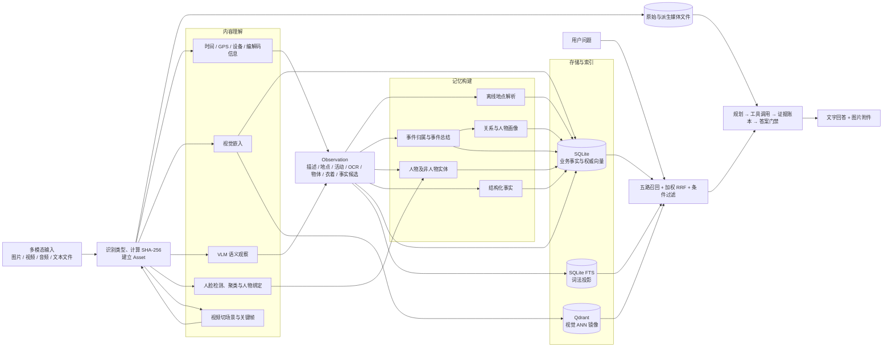
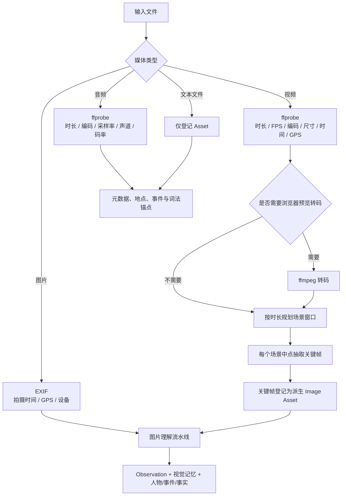
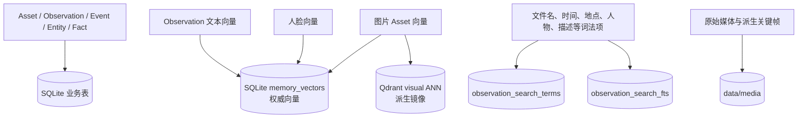
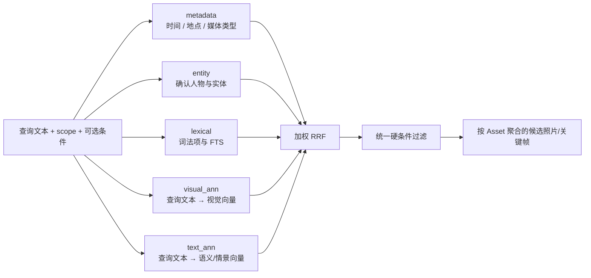
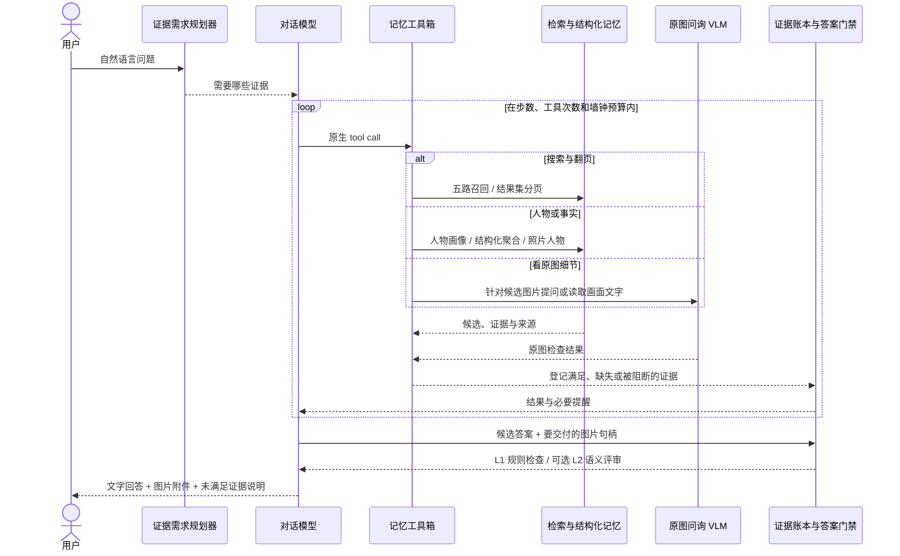

# Sentrix 多模态数据到记忆回答的完整链路

> 本文只讲数据链路：多模态数据如何进入系统、被处理成什么、存到哪里、如何被检索，以及最后怎样形成文字与图片回答。不讨论页面、接口分层和工程目录组织。

## 目录

- [1. 一句话理解整条链](#1-一句话理解整条链)
- [2. 总体数据流](#2-总体数据流)
- [3. 输入、去重与资产落库](#3-输入去重与资产落库)
- [4. 不同模态怎样进入统一链路](#4-不同模态怎样进入统一链路)
- [5. 图片语义与记忆构建](#5-图片语义与记忆构建)
- [6. 数据最终存在哪里](#6-数据最终存在哪里)
- [7. 查询怎样召回数据](#7-查询怎样召回数据)
- [8. 召回结果怎样变成回答](#8-召回结果怎样变成回答)
- [9. 从输入到回答的字段血缘](#9-从输入到回答的字段血缘)
- [10. 各模态当前能回答到什么程度](#10-各模态当前能回答到什么程度)
- [11. 失败、降级与幂等](#11-失败降级与幂等)
- [12. 阅读代码的最短路径](#12-阅读代码的最短路径)
- [13. 术语表](#13-术语表)

## 1. 一句话理解整条链

系统先把照片、视频、音频等输入统一登记为 `Asset`，再把可理解的内容提炼成 `Observation`；随后围绕 Observation 建立地点、视觉向量、人物、人脸、事件、实体、事实和词法索引。用户提问时，系统从元数据、人物实体、词法、视觉向量和文本向量五路召回候选，再由 Agent 继续查看人物、事实或原图，经过证据门禁后输出文字答案和图片附件。

这条链里最关键的三个对象是：

```text
Asset        原始或派生媒体：文件是什么、在哪里、何时何地拍摄
Observation  系统从媒体中看到了什么：描述、地点、活动、物体、文字等
Event        多个 Observation 是否属于同一次家庭活动
```

可以把 `Observation` 看作整套系统的“语义中轴”：输入侧把不同模态尽量转成 Observation，记忆侧围绕它建立事件和事实，检索侧再通过它找到原始 Asset。

## 2. 总体数据流



主链可以压缩成八步：

```text
输入 → Asset → Observation → 事件/人物/事实 → 向量与词法索引
→ 多路召回 → Agent 补充取证 → 文字与图片回答
```

## 3. 输入、去重与资产落库

### 3.1 输入形态

系统有两种实际输入形态：

- 单文件输入：传入文件名、MIME、字节内容和 `scope_id`；
- 目录批量输入：扫描目录中的图片、视频和音频，按文件名排序后逐个处理。

批量扫描支持：

| 模态 | 常见后缀 |
|---|---|
| 图片 | jpg、jpeg、png、heic、heif、webp |
| 视频 | mp4、mov、m4v、avi、mkv |
| 音频 | wav、mp3、m4a、aac、flac、ogg |

领域模型还能识别 GIF、TIFF 和文本类型，但目录批量扫描不会主动收文本文件；文本主要只能通过单文件入口进入。

### 3.2 统一登记过程

每个输入首先执行：

1. 确保 `scope_id` 对应的记忆空间存在；
2. 对文件字节计算 SHA-256；
3. 在当前 scope 内检查是否已有相同哈希；
4. 未命中时保存原文件；
5. 根据 MIME 或后缀判断媒体类型；
6. 读取该模态的基础元数据；
7. 建立一条 `Asset` 记录。

`Asset` 主要保留：

```text
id、scope_id、file_name、media_type、path、mime_type
size_bytes、content_sha256、captured_at、GPS、status
视频关键帧还会带 parent_asset_id、derived_kind、source_timestamp_sec
```

去重范围是 scope 内部，同一文件放进不同相册可以分别存在。命中重复文件时，不重复保存、不重复创建事件，只重跑视觉索引和地点解析等幂等步骤。

## 4. 不同模态怎样进入统一链路



### 4.1 图片

图片是当前语义最完整的模态。整册导入中的图片会经历：

- EXIF 元数据读取；
- GPS 离线地点解析；
- 图像向量编码；
- VLM 语义观察；
- 人脸检测、向量、聚类和人物提及；
- 事件归属；
- 文本向量、实体、事实和词法投影。

需要注意：单文件快速导入当前使用 `observe=False`，因此会建 Asset、视觉向量、人脸、事件和词法锚点，但不会主动跑完整 VLM 语义观察。整册导入以及视频关键帧使用 `observe=True`，才会生成完整语义字段。

### 4.2 视频

视频原片首先作为 Video Asset 保存，然后：

1. 使用 ffprobe 读取时长、帧率、尺寸、编码、旋转、拍摄时间、GPS、设备和帧数；
2. 非 H.264 等情况按需生成浏览器预览转码件；
3. 根据视频时长规划场景窗口；
4. 每个窗口在中点附近抽一帧；
5. 每帧作为带血缘的派生 Image Asset；
6. 为每个场景建立 `video_scene` 事件；
7. 关键帧走完整图片理解流水线，并强制挂到对应视频场景事件。

因此，系统理解视频内容的主要方式不是直接给整段视频做多模态推理，而是“视频元数据 + 场景关键帧”。检索命中关键帧后，可以通过 `parent_asset_id` 和 `source_timestamp_sec` 回到原片及对应时间点。

### 4.3 音频

音频当前只做：

- 原文件保存；
- 时长、编码、采样率、声道、码率、拍摄时间和 GPS 探测；
- 地点、事件和词法锚点构建。

音频不转码，也没有 ASR/语音转写。因此系统可以按文件名、时间、地点等找到音频，但不能根据音频中“说了什么”进行内容问答。

### 4.4 文本文件

文本类型可以被媒体模型识别并登记为 Asset，但当前没有独立的文本内容解析器。它不会自动把文件正文写入 Observation，也不会形成文本向量。当前更接近“文件资产占位”，而不是完整的文档问答链路。

## 5. 图片语义与记忆构建

### 5.1 两段式执行

整册导入把图片处理拆成两段：

```text
prepare：只做计算，不写业务数据，可并行
commit：读取前面已经写入的记忆并提交结果，必须按文件顺序串行
```

`prepare` 并行执行三类重计算：

- 视觉嵌入；
- VLM 观察；
- 人脸检测。

`commit` 严格按 `sorted(paths)` 执行，因为事件归属和人脸聚类需要读取同批前面图片刚写入的事件、向量、人物提及和人脸簇。改成“谁先算完谁先提交”不会报错，但会让同一批数据形成不同的事件和人物簇。

### 5.2 串行提交顺序

当前硬顺序是：

```text
地点解析
→ 视觉向量写入
→ 建立 Observation
→ 写入 VLM 语义
→ 人脸登记
→ 事件归属
→ 文本向量
→ 非人物实体
→ 结构化事实
→ 词法投影
```

### 5.3 Observation 的语义内容

VLM 会尝试产生：

| 字段 | 含义 |
|---|---|
| `caption` | 图片的自然语言描述 |
| `place` | 画面表现出的地点 |
| `activity` | 人物或场景中的活动 |
| `event_type` | 事件类型 |
| `ocr_text` | 画面中的文字 |
| `objects` | 可见物体 |
| `clothing` | 衣着信息 |
| `facts` | 模型提出的结构化事实候选 |
| `confidence` | 观察置信度 |

观察失败不会让导入失败。模型不可用、图片无法读取或返回内容不是有效 JSON 时，Asset 仍然保留，Observation 可以只有基础字段。

### 5.4 地点记忆

GPS 先被解析成两类互补信息：

- PyGeoCN：省、市、区县等行政区；
- GeoNames：附近的乡镇、村庄或兴趣点。

结果写入 `asset_places`。这条链纯离线，没有逐张网络反向地理编码。事件创建时会把地点显示名和行政区复制到事件中，便于时间线和地点查询。

### 5.5 人脸与人物记忆

人脸链路执行：

```text
检测人脸 → 对齐与人脸向量 → 与已有簇匹配
→ 新建或更新人脸簇 → 写人脸实例和原型
→ 若簇已绑定确认人物，则写人物提及
```

人脸登记必须早于事件归属，因为事件聚类的一个重要信号是“这张照片和候选事件是否出现相同的已确认人物”。批末还会把确认人物刷新成事件参与者，并据此改写事件摘要。

### 5.6 事件记忆

一条 Observation 会在当前 scope 的活动事件中寻找候选：

1. 先用 6 小时时间窗做硬过滤；
2. 综合时间、GPS、视觉地点、事件类型、活动、物体、人物和视觉相似度打分；
3. 最佳候选达到阈值 0.50 时折入已有事件；
4. 否则创建新事件。

视觉向量和人物提及必须先写，事件打分才能使用视觉相似度和人物重合度。批量完成后，每个本批涉及的事件最多调用一次模型生成事件标题、类型和摘要；总结失败不会回滚事件，只会保留占位摘要。

### 5.7 实体与事实

非人物实体从 Observation 中提取：

- 地点实体；
- 物件实体；
- 时间实体。

它们会与 Observation、Event 关联，并建立“出现在”“记录于”等关系。

`facts` 不是模型说什么就直接当成真事实。候选至少要经过：

- 主体必须是当前 scope 内已确认人物的本名；
- 主体、谓词、客体必须通过可写性规则；
- 与已有事实比较，决定新增、强化还是以新版本替代。

### 5.8 批末派生记忆

整册导入结束后还会执行：

- 事件总结；
- 已确认人物到事件参与者的刷新；
- 有新事件时尝试推断家庭图谱；
- 有新媒体时生成人物瞬间、外观证据和人物画像。

这些都是基于已落库记忆的二次推导，不改变原始媒体文件。

## 6. 数据最终存在哪里



### 6.1 SQLite 业务事实

主要保存：

- Asset、Observation 与媒体探测结果；
- 地点、事件、事件成员与事件参与者；
- 人脸簇、实例、原型、人物和实体；
- 关系、家庭图谱、人物画像；
- 事实及其证据；
- 对话、消息、回合、证据需求、事件轨迹和结果集。

### 6.2 权威向量

`memory_vectors` 是向量事实源，记录：

```text
scope、space、source_type、source_id、model_name、dimension、vector、metadata
```

三个主要空间：

| space | 内容 |
|---|---|
| `visual` | 图片资产向量；人脸向量也使用该 space，但靠 source_type 和 model_name 隔离 |
| `semantic` | Observation 的语义文本向量 |
| `episodic` | Observation 和 Event 维度的文本向量 |

文本 Observation 会把同一条文本向量写入 semantic 和 episodic；有关联事件时还会增加 event 记录。文本内容由 caption、activity、place、OCR、clothing、facts 和 objects 按固定顺序拼成。

### 6.3 Qdrant 镜像

当前只有视觉资产向量镜像到嵌入式 Qdrant，用于快速 ANN 检索。SQLite 向量先写，Qdrant 后写；Qdrant 写失败不撤销 SQLite。文本向量当前直接在 SQLite 权威存储上做精确相似度搜索。

### 6.4 词法索引

Observation 还会投影成词法项和 FTS 内容，包括语义描述以及文件名、时间、地点、人物等确定性锚点。它负责处理向量模型不擅长的精确词、人名、地名和文件名查询。

## 7. 查询怎样召回数据

用户问题会同时驱动五条召回通道：



### 7.1 metadata 通道

对时间范围、媒体类型和地点执行确定性过滤。没有正向结构化条件时，这条通道不会把整个相册都作为候选返回。

### 7.2 entity 通道

根据已确认人物、人物提及和实体锚点找到相关资产。它是精确人物条件的重要来源。

### 7.3 lexical 通道

对文件名、描述、OCR、地点、人名、物体等词法投影进行搜索，适合精确词和专有名词。

### 7.4 visual ANN 通道

把用户查询文本编码进视觉空间，与图片向量比较：

- Qdrant 可用且条数与 SQLite 权威向量一致时，使用 Qdrant；
- Qdrant 不可用、为空或落后时，回退 SQLite 精确余弦检索；
- 查询模型、维度或方案不一致时标记降级。

默认 `wemm` 方案的图片和查询文本处于同一个 2048 维空间，因此支持“海边”“红衣服”“一家人吃饭”等跨模态检索。

### 7.5 text ANN 通道

把查询文本编码后，在 semantic 和 episodic 两个空间中搜索 Observation 文本向量。命中是 Observation 级，最终按 `asset_id` 聚合；同一资产有多个命中时取最大相似度。

### 7.6 融合与过滤

五路结果使用加权 RRF：

```text
visual_ann 2.5
lexical    1.0
metadata   1.0
entity     1.0
text_ann   0.5
```

metadata 和 entity 属于确定性 anchor，命中后还有固定加成。融合完成后再统一检查时间、人物、地点和媒体类型等硬条件，避免候选从另一通道绕过过滤。

## 8. 召回结果怎样变成回答

直接搜索到这里已经可以返回候选媒体；自然语言问答还会继续进入 Agent 取证链。



### 8.1 规划

规划器先把问题拆成证据需求，例如：

- 需要相关照片；
- 需要某个人物画像；
- 需要结构化事实或计数；
- 需要检查某张原图；
- 最终必须交付原图。

规划失败时不会伪造一个需求继续检索，而是以明确的 `planner_blocked` 结束。

### 8.2 工具取证

Agent 可以使用的主要能力包括：

| 能力 | 作用 |
|---|---|
| `search_memories` | 调用五路检索获取候选资产和 ResultSet |
| `get_result_page` | 翻页读取更多候选 |
| `get_person_profile` | 读取人物画像、关系和归属 |
| `query_memory_facts` | 做结构化事实、计数、分组和样本查询 |
| `query_photo_people` | 查看照片上的已确认与未绑定人物证据 |
| `inspect_photo` | 拿用户问题去询问一张原图，可带人物裁剪定位 |
| `read_photo_text` | 针对原图做文字读取 |
| `final_answer` | 同一步提交答案和要交付的图片句柄 |

导入期 VLM 和问答期 PhotoInspector 是两种不同能力：前者生成固定 Observation 字段并持久化，后者针对当前问题临时查看原图，不把任意问答结果写回 Observation。

### 8.3 证据门禁

每次工具调用都会更新 Evidence Ledger。回答提交前至少经过：

- 工具与证据是否满足规划需求；
- 答案中是否出现无证据支撑的具体断言；
- 用户要求图片时是否真的选择了附件；
- L1 确定性规则检查；
- 有条件时进行一次 L2 语义忠实度评审。

门禁不通过时，模型会收到一次针对性提醒并继续取证或重写；预算耗尽时，系统使用已有证据收尾，并保留未满足需求及终止原因。

### 8.4 最终产物

一个完整回答包括：

```text
answer              最终文字
attachments         交付的原图/关键帧引用
requirements        每项证据需求是否满足、由什么满足
termination_reason  正常完成、部分完成、超时、模型错误等
retrieved_candidates 检索过的候选
trace               模型调用、工具步骤和门禁轨迹
```

## 9. 从输入到回答的字段血缘

| 输入信息 | 中间形态 | 最终用途 |
|---|---|---|
| 文件字节 | SHA-256、文件路径、Asset | 去重、原件交付 |
| MIME/后缀 | `media_type` | 模态分流与媒体类型过滤 |
| EXIF/容器时间 | `captured_at`、时间实体、Event 时间 | 时间线、时间筛选、问“哪年/哪天” |
| GPS | `GpsPoint`、`asset_places`、Event 地点 | 地点检索、地点实体、事件聚类 |
| 图像像素 | visual vector | 跨模态视觉检索、事件视觉相似度 |
| VLM 描述 | caption/activity/place/event_type | 文本向量、FTS、事件摘要 |
| 画面文字 | `ocr_text` | 词法检索、文本向量、问答证据 |
| 物体与衣着 | objects/clothing | 词法与文本向量、实体、人物问答 |
| 人脸 | face instance/cluster/prototype | 人物搜索、事件人物信号、关系与画像 |
| 事实候选 | Fact + evidence_ids | 结构化问答与统计 |
| 视频关键帧 | 派生 Image Asset + 场景 Event | 视频内容检索、回到原片时间点 |
| 用户问题 | 查询向量、结构化条件、证据需求 | 多路召回与 Agent 工具选择 |

## 10. 各模态当前能回答到什么程度

| 模态 | 内容理解 | 可检索依据 | 回答能力 |
|---|---|---|---|
| 整册图片 | 完整 | 视觉、语义文本、OCR、人物、地点、时间、实体、事实 | 最完整，可回答画面、人物、活动、地点并交付原图 |
| 单文件图片快速导入 | 部分 | 视觉向量、人脸、时间、地点、文件名 | 能视觉搜索；缺少持久化 caption/OCR 等完整语义 |
| 视频 | 关键帧级 | 视频元数据 + 关键帧的完整图片索引 | 可按场景内容检索，并定位到原片时间点 |
| 音频 | 仅元数据 | 文件名、时间、地点、媒体类型 | 能找到音频，不能回答音频里说了什么 |
| 文本文件 | 仅资产登记 | 文件名及有限元数据 | 暂不具备正文语义检索和文档问答 |

## 11. 失败、降级与幂等

| 情况 | 系统行为 |
|---|---|
| 同 scope 重复文件 | 不重复存储和建事件，只重跑幂等索引步骤 |
| 单个文件处理失败 | 批量任务记录文件名和原因，其余文件继续 |
| EXIF 读取失败 | 时间/GPS 为空，Asset 继续入库 |
| 视频/音频探测失败 | 错误写入媒体元数据，原文件继续保留 |
| VLM 观察失败 | Observation 保持空语义，不中断导入 |
| 嵌入服务不可用 | 不写空向量，检索健康状态标记降级 |
| Qdrant 不可用或落后 | 回退 SQLite 权威向量精确搜索 |
| 人脸权重缺失 | 人脸结果为空，其余记忆链继续 |
| 请求 CUDA 但实际退到 CPU | 明确报错，防止静默性能退化 |
| 事件总结失败 | 事件仍保留，摘要保持占位内容，可后续重跑 |
| Agent 某条召回通道失败 | 记录 channel trace，其他通道继续 |
| 模型上下文过长 | 丢弃最旧工具往返并重试，无法压缩时明确结束 |
| Agent 预算耗尽 | 基于已有证据收尾，记录未满足需求和终止原因 |

最重要的权威关系是：

```text
原始媒体文件是内容权威
SQLite 业务表是记忆权威
SQLite memory_vectors 是向量权威
Qdrant 和 FTS 是可重建查询投影
```

## 12. 阅读代码的最短路径

如果要顺着这条链读代码，建议按下面顺序：

1. [`ImportAssets`](../../apps/api/src/sentrix/application/media/import_assets.py)：输入到记忆构建的主链；
2. [`ImportAlbum`](../../apps/api/src/sentrix/application/media/import_album.py)：批量并行 prepare、顺序 commit 和批末总结；
3. [`ExtractVideoScenes`](../../apps/api/src/sentrix/application/media/extract_video_scenes.py)：视频到关键帧再回图片主链；
4. [`Observation` 和媒体模型](../../apps/api/src/sentrix/domain/media/models.py)：Asset、Observation 与媒体元数据；
5. [`AssignEvents`](../../apps/api/src/sentrix/application/memories/assign_events.py)：Observation 如何组成 Event；
6. [`IndexObservationText`](../../apps/api/src/sentrix/application/retrieval/index_observation_text.py)：语义文本如何进入向量空间；
7. [`RetrieveEvidence`](../../apps/api/src/sentrix/application/retrieval/retrieve_evidence.py)：五路召回与融合；
8. [`AssistantToolbox`](../../apps/api/src/sentrix/application/assistant/tools.py)：Agent 如何读取检索、人物、事实和原图；
9. [`RunTurn`](../../apps/api/src/sentrix/application/assistant/run_turn.py)：规划、工具循环、证据门禁与回答。

## 13. 术语表

| 术语 | 含义 |
|---|---|
| Asset | 一份已登记的原始或派生媒体 |
| Observation | 从 Asset 中提炼出的语义观察 |
| Event | 一组属于同次活动的 Observation |
| Scope | 一册相册或一个隔离的记忆空间 |
| Entity | 人物、地点、物件、时间等可关联对象 |
| Fact | 带主体、谓词、客体和证据的结构化记忆 |
| Visual vector | 从图片像素编码得到的向量 |
| Text vector | 从 Observation 语义文本编码得到的向量 |
| ANN | 近似最近邻搜索；本项目视觉 ANN 使用 Qdrant |
| FTS | 全文检索；本项目使用 SQLite FTS5 |
| RRF | Reciprocal Rank Fusion，多路召回的排名融合算法 |
| Evidence Ledger | Agent 用来记录证据需求、满足情况和缺口的账本 |
| Attachment | 最终回答中交付给用户的原图或关键帧引用 |

---

### 主要代码依据

- `apps/api/src/sentrix/application/media/import_assets.py`
- `apps/api/src/sentrix/application/media/import_album.py`
- `apps/api/src/sentrix/application/media/extract_video_scenes.py`
- `apps/api/src/sentrix/application/media/observe_asset.py`
- `apps/api/src/sentrix/application/media/index_place.py`
- `apps/api/src/sentrix/application/media/maintain_entities.py`
- `apps/api/src/sentrix/application/identity/enroll_face.py`
- `apps/api/src/sentrix/application/memories/assign_events.py`
- `apps/api/src/sentrix/application/memories/maintain_facts.py`
- `apps/api/src/sentrix/application/retrieval/index_visual.py`
- `apps/api/src/sentrix/application/retrieval/index_observation_text.py`
- `apps/api/src/sentrix/application/retrieval/retrieve_evidence.py`
- `apps/api/src/sentrix/application/assistant/tools.py`
- `apps/api/src/sentrix/application/assistant/run_turn.py`
