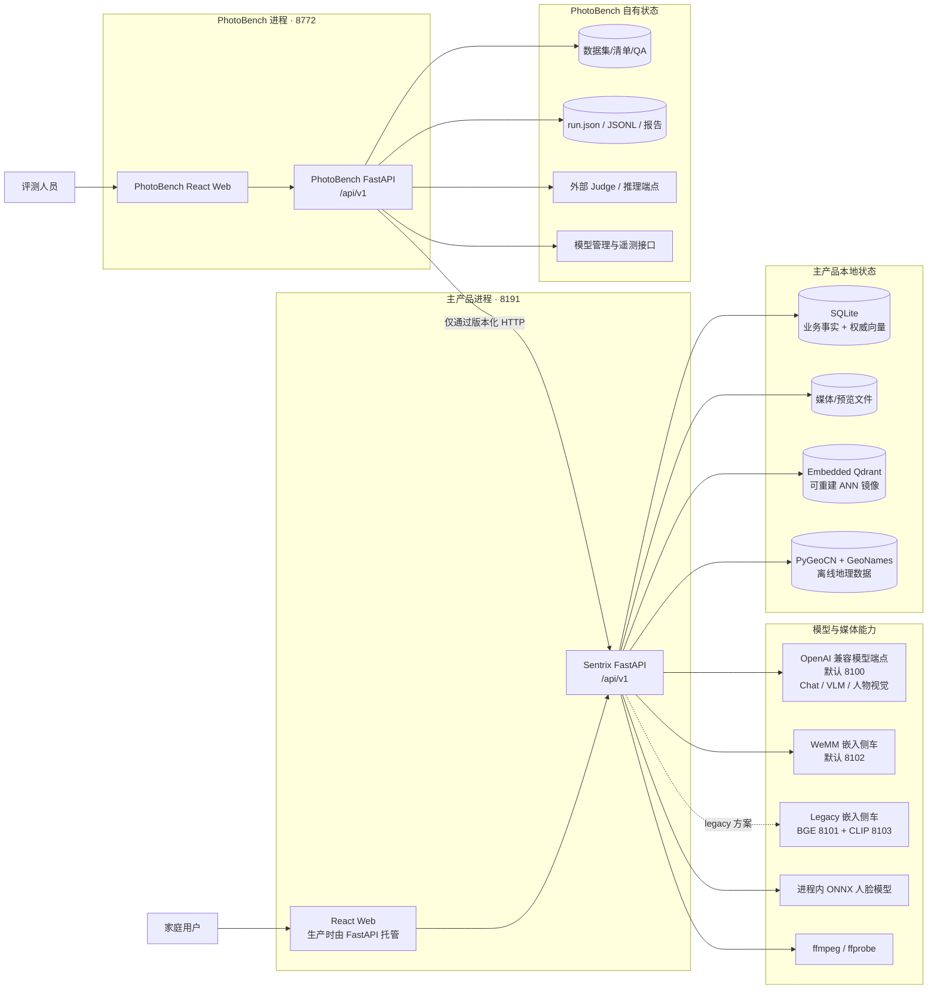
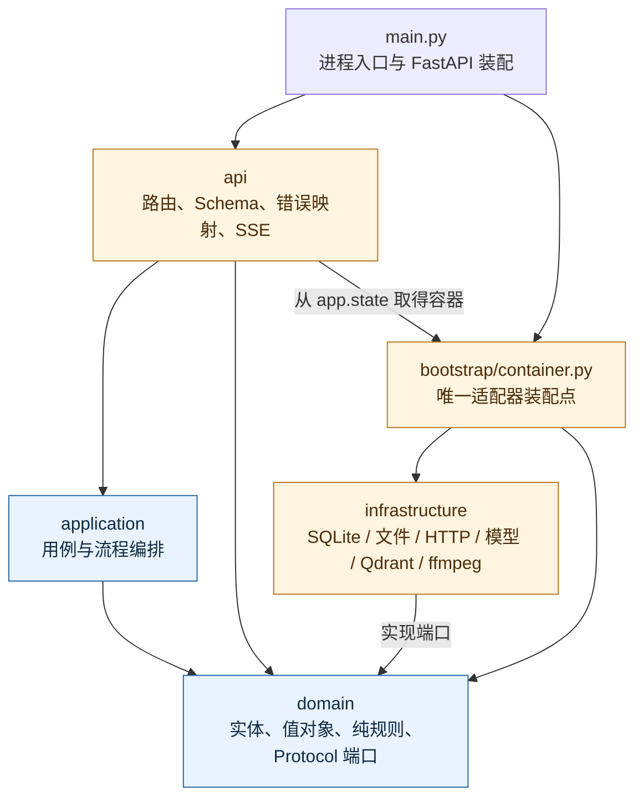
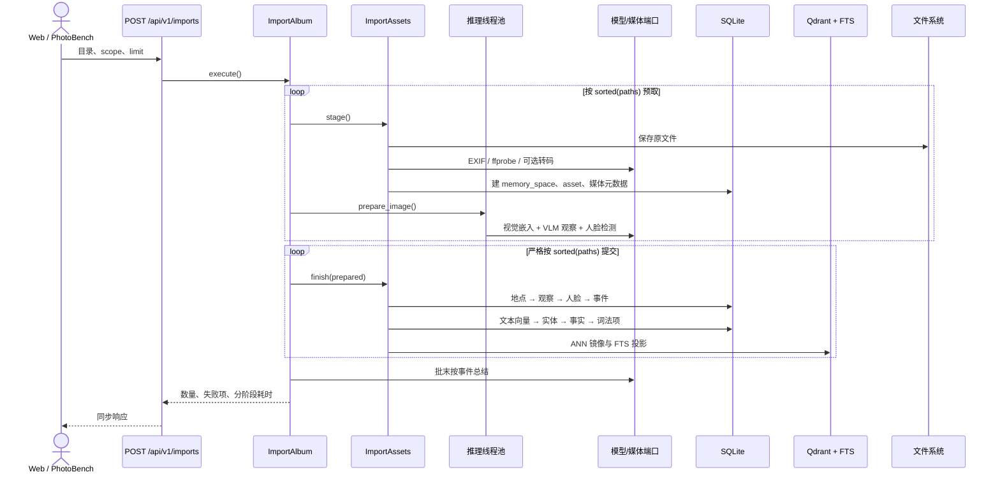
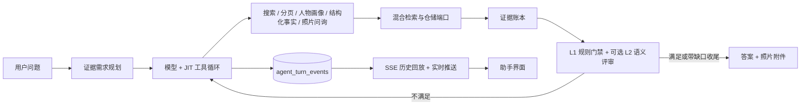
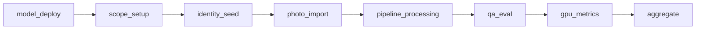

# Sentrix Home Web 2.0 架构总览

> 本文面向第一次接触仓库的开发者。结论以当前代码、配置、迁移脚本和部署文件为准；历史设计文档只用于交叉验证。

## 目录

- [1. 一句话结论](#1-一句话结论)
- [2. 系统全景](#2-系统全景)
- [3. 仓库与进程边界](#3-仓库与进程边界)
- [4. 主产品后端的四层架构](#4-主产品后端的四层架构)
- [5. 主产品的领域划分](#5-主产品的领域划分)
- [6. 三条核心运行链路](#6-三条核心运行链路)
- [7. 数据与状态](#7-数据与状态)
- [8. 前端架构](#8-前端架构)
- [9. PhotoBench 架构](#9-photobench-架构)
- [10. 配置与部署](#10-配置与部署)
- [11. 架构约束与质量门禁](#11-架构约束与质量门禁)
- [12. 架构评价与风险](#12-架构评价与风险)
- [13. 推荐阅读顺序](#13-推荐阅读顺序)
- [14. 术语表](#14-术语表)

## 1. 一句话结论

Sentrix Home Web 2.0 是一个面向家庭照片、视频和记忆问答的系统。它不是微服务集群，而是：

- 一个采用端口/适配器思想的 Python 模块化单体 `sentrix`；
- 两个 React 前端：主产品 Web 和 PhotoBench Web；
- 一个与主产品隔离部署的评测应用 `photobench`；
- 若干进程外模型侧车，以及本地 SQLite、文件存储和嵌入式 Qdrant。

主产品的核心设计是“业务规则与技术实现分离”：`domain` 定义模型和端口，`application` 编排用例，`infrastructure` 实现数据库、文件、模型和索引适配器，`api` 负责 HTTP/SSE 映射，`bootstrap` 完成依赖装配。

## 2. 系统全景



最重要的边界有两条：

1. PhotoBench 不得导入 `sentrix` 的 Python 模块，也不得直接读主产品数据库；两者只通过 `/api/v1` 通信。
2. SQLite 中的业务记录和 `memory_vectors` 是事实源，Qdrant 只是可重建的加速索引，不能反客为主。

## 3. 仓库与进程边界

```text
apps/
├── api/                    主产品 Python 包 sentrix
├── web/                    主产品 React + TypeScript + Vite
└── photobench/
    ├── src/photobench/     独立评测后端
    └── web/                独立评测前端
packages/contracts/openapi/ 两个应用导出的 OpenAPI 3.1 契约
deploy/systemd/             主 API、PhotoBench、WeMM 侧车的 user service
docs/                       架构、ADR、重构记录和运维手册
scripts/                    契约导出、架构检查、部署与维护脚本
```

实际运行时通常有两个仓库内服务进程：

| 进程 | 默认端口 | 职责 | 自有状态 |
|---|---:|---|---|
| Sentrix API | 8191 | 产品 API、主 Web 静态资源、导入、检索、助手 | SQLite、媒体、预览、Qdrant、地理数据 |
| PhotoBench API | 8772 | 评测编排、结果查看、Judge、运行时遥测 | 数据集、配置、结果文件 |

开发时前端分别由 Vite 运行：主 Web 使用 4274 并代理到 8191，PhotoBench Web 使用 4276 并代理到 8772。生产构建后，各自的 FastAPI 进程把对应 `dist/` 挂载到 `/`。

## 4. 主产品后端的四层架构

### 4.1 依赖方向



约束可以概括为：

- `domain` 不知道 FastAPI、SQLite、PIL、HTTP 客户端或 Qdrant 的存在；
- `application` 只依赖领域对象和端口，不直接导入基础设施实现；
- `infrastructure` 实现领域端口，不反向调用 API 或应用层；
- `api` 只做请求/响应、错误与流式事件映射；
- 具体适配器只允许在 `Container.build()` 中构造；
- `main.py` 使用应用工厂，导入模块本身不会建目录、迁移数据库或启动线程。

这套结构接近六边形架构/整洁架构，但仍保留务实做法：部分简单读接口直接通过容器中的仓储端口读取投影，不会为每个只读查询都额外造一个用例类。

### 4.2 依赖注入方式

`Container` 的字段按 `domain/**/ports.py` 中的 `Protocol` 声明，具体实现只出现在 `build()` 内。例如：

- `AssetRepository` → `SqliteAssetRepository`；
- `VectorIndex` → `QdrantVectorIndex`；
- `ChatModel` → `OpenAIChatModel`；
- `PlaceResolver` → `OfflinePlaceResolver`；
- `TurnEventBroker` → `InProcessTurnEventBroker`。

容器被挂到 `app.state.container`，路由通过依赖函数取得它。应用用例一般在路由的构建函数中使用这些端口创建，因此“适配器选择”集中在容器，“用例组装”靠近接口入口。

## 5. 主产品的领域划分

| 领域 | 核心职责 | 主要落点 |
|---|---|---|
| Media | 媒体入库、EXIF、视频/音频探测、转码、关键帧、视觉观察 | `domain/media`、`application/media` |
| Memories | 事件归属、时间线、事实候选、事实审核、事件总结 | `domain/memories`、`application/memories` |
| Identity | 人脸、人物/实体、外观、画像、关系、家庭图谱 | `domain/identity`、`application/identity` |
| Retrieval | 元数据、实体、词法、视觉 ANN、文本 ANN、条件过滤、融合 | `domain/retrieval`、`application/retrieval` |
| Assistant | 会话、回合、规划、工具循环、证据账本、答案门禁、SSE | `domain/assistant`、`application/assistant` |
| Places | 行政区解析、最近地点、地点别名 | `domain/places`、`infrastructure/places` |
| Spaces | 相册/记忆空间 | `domain/spaces` |

领域之间通过端口和应用用例协作，而不是让数据库表成为跨模块 API。导入链是这些领域的主要汇合点：一份媒体会逐步变成资产、观察、向量、地点、人物、事件、实体、事实和词法投影。

## 6. 三条核心运行链路

### 6.1 媒体导入与记忆构建

整册导入是同步 HTTP 请求，但内部采用“两段式”执行：推理阶段可并行，提交阶段必须按文件排序串行。串行提交不是性能妥协，而是业务语义：后来的照片要读取前面照片刚写出的事件、向量和人物提及，乱序会改变事件聚类结果。



关键顺序是：

```text
存储/元数据 → 地点 → 视觉向量 → Observation → 语义富集
→ 人脸登记 → 事件归属 → 文本向量 → 实体 → 事实 → 词法投影
```

视频会额外经过 ffprobe、必要的 H.264 预览转码、场景切分和关键帧抽取；关键帧作为派生资产重用同一条图片流水线。音频只入库和探测元数据，不转码、不做 ASR。

### 6.2 混合检索与助手

普通搜索会在逻辑上聚合五类召回信号；当前实现按固定顺序调用通道，并记录每条通道的健康轨迹：

1. metadata：时间、地点、媒体类型等结构化锚点；
2. entity：已确认人物/实体；
3. lexical：SQLite 词法投影与 FTS；
4. visual ANN：文本到视觉空间的检索；
5. text ANN：观察文本向量检索。

通道结果使用加权 RRF 融合，再统一执行硬条件过滤。单一通道失败不会让整次搜索失败，但响应会在 `channel_trace`、`degraded` 和 `degraded_reason` 中暴露降级。

助手在检索之上增加了有状态的 Agent 循环：



回合执行由后台 daemon thread 驱动；事件先写 SQLite，再通过进程内 broker 推给在线 SSE 订阅者。断线重连时，历史部分从 `agent_turn_events` 补发，broker 只负责实时部分。

### 6.3 PhotoBench 评测

PhotoBench 的完整 run 依次经过八个阶段：



- `full` 模式执行全部阶段；
- `reuse` 模式复用已有 scope，只执行 `scope_setup → qa_eval → gpu_metrics → aggregate`；
- run 在进程内线程中执行，状态持续写入结果文件；
- QA 通过 `SentrixClient` 调主产品公开 API，不触碰主产品内部模块；
- Judge、推理服务生命周期和 GPU/内存遥测都抽象为端口，可按运行环境选择实现。

## 7. 数据与状态

### 7.1 主产品

| 状态 | 角色 | 说明 |
|---|---|---|
| SQLite `sentrix.db` | 业务事实源 | 13 个版本化迁移；WAL；资产、观察、事件、事实、身份、家庭图谱、会话、回合等 |
| SQLite `memory_vectors` | 向量事实源 | 保存模型名、空间、维度和元数据，换嵌入方案时作为重建依据 |
| SQLite FTS5/词法表 | 可重建查询投影 | 支撑 lexical/entity 锚点检索 |
| Embedded Qdrant | 可重建 ANN 镜像 | 不可用时可降级，但必须在健康状态和搜索响应中可见 |
| `data/media` | 原始与派生媒体 | 原图、视频、关键帧、转码件 |
| `data/previews` | 展示预览 | 由 `SENTRIX_DATA_DIR` 派生 |
| `data/geo` | 离线地理数据 | GeoNames 数据；行政区能力还使用 PyGeoCN 自带数据 |
| 进程内 broker | 瞬时事件 | 只承载当前回合 SSE 实时推送，不是历史事实源 |

SQLite 表大体可分为：

- 媒体：`assets`、`observations`、`ingest_batches`；
- 记忆：`events`、`event_observations`、`facts`、搜索词和 FTS；
- 身份：`entities`、人脸簇/实例/原型、人物画像、关系、家庭图谱；
- 检索：`memory_vectors`、地点投影；
- 助手：会话、消息、回合、回合事件、结果集。

### 7.2 PhotoBench

PhotoBench 不使用主产品数据库。它把数据集、配置和结果保持为独立的文件体系：

- `datasets/`：相册 manifest、QA 与参考媒体；
- `config/`：运行时连接、Judge provider、提示词和密钥引用；
- `results/<run_id>/`：`run.json`、`results.jsonl`、`gpu_samples.jsonl` 及导出产物。

这种设计便于保留评测证据和离线分析，但结果索引、活动 run 和后台线程都是单进程模型。

## 8. 前端架构

### 8.1 主产品 Web

主 Web 是 React 19 + TypeScript + Vite + React Router。结构采用“应用壳 + feature 页面 + shared API/UI”：

```text
src/
├── app/               路由、导航、ScopeProvider、应用壳
├── features/          assistant、imports、knowledge、library、people、search、timeline 等
├── shared/api/        手写的 /api/v1 客户端与传输类型
├── shared/ui/         通用组件
└── styles/            token、壳层与功能样式
```

十个页面路由由一张 `ROUTES` 表集中管理。相册/记忆空间通过 `ScopeProvider` 进入各功能页。API 客户端统一使用 `/api/v1`，错误按后端 `{code, message, detail}` 契约解析。助手通过 SSE 接收过程事件。

### 8.2 PhotoBench Web

PhotoBench Web 同样使用 React 19 + TypeScript + Vite，并额外使用 ECharts。它按 config、runs、QA、memory 等 feature 划分，但没有 React Router；视图状态由组件内状态切换，因此没有深链接语义。

两个前端各自维护 API 类型；仓库同时把后端 OpenAPI 导出到 `packages/contracts/openapi/`，CI 检查导出物是否与代码一致，但当前没有看到从 OpenAPI 自动生成并共享前端客户端的落地目录。

## 9. PhotoBench 架构

PhotoBench 自己也遵循 `api → application → domain`、`infrastructure → domain` 的四层规则，并拥有独立 `Container`。关键端口包括：

- `SentrixClient`：主产品的语义化 HTTP 客户端；
- `AlbumSource` / `QaMetadataSource`：数据集读取；
- `RunStore` / `RunResultWriter`：结果索引和落盘；
- `InferenceProvider` / `LifecycleProvider` / `TelemetryProvider`：模型调用、生命周期和遥测；
- `ConfigStore` / `SecretEnvStore`：配置与密钥引用；
- `SentrixProcess`：在需要切换模型时重启或探测主 API。

`photobench-isolation` 契约明确禁止 `photobench` import `sentrix`。因此，同仓只是便于共同开发和统一门禁，不代表两个应用共享内部代码或数据库。

## 10. 配置与部署

### 10.1 主产品配置

主产品使用 Pydantic Settings，环境变量前缀为 `SENTRIX_`。核心配置分三类：

- 数据根：`SENTRIX_DATA_DIR`，数据库、媒体、预览、Qdrant 和地理目录都由它派生；
- 服务端点：VLM 8100、WeMM 8102、legacy BGE 8101、legacy CLIP 8103；
- 运行参数：API 地址、模型超时、上下文窗口、相册推理并发等。

嵌入只允许按具名方案整体切换：

| 方案 | 视觉 | 文本 | 特征 |
|---|---|---|---|
| `wemm`（默认） | WeMM 2048d | WeMM 2048d | 图文统一空间，视觉/文本槽共用一个客户端实例 |
| `legacy` | Chinese-CLIP 768d | BGE-M3 1024d | 面向 16 GB Mac 等低资源机器 |

切换方案必须重建向量；模型名和维度共同定义索引空间。

### 10.2 进程管理

仓库提供 `systemd --user` 单元：

- `sentrix-api.service`；
- `sentrix-photobench.service`；
- `sentrix-wemm-sidecar.service`。

前两个由 `make start/stop/restart` 一起管理；WeMM 侧车刻意独立，不属于主产品生命周期。开发命令则分别是 `make dev`、`make photobench-dev`、`make web-dev` 和 `make photobench-web-dev`。

## 11. 架构约束与质量门禁

架构不是只写在文档里，根 `pyproject.toml` 定义了 11 条 import-linter 契约，包括：

- 主产品 domain/application/api/infrastructure 的纯度与层级；
- PhotoBench 对应四层的纯度与层级；
- PhotoBench 对 Sentrix Python 包的隔离。

`make ci` 还串联：

- Ruff lint 和格式检查；
- mypy strict；
- 模块与端口方法的生产可达性检查；
- 模块地图、能力地图和 OpenAPI 防腐检查；
- domain/application 覆盖率门槛 85%；
- 两个前端的 TypeScript、oxlint、Vitest 和 Vite build。

当前测试分布覆盖主 API 的 unit/contract/integration/e2e、PhotoBench 后端，以及两个前端。架构地图还会双向校验 Python 文件集合和包内 import 边，新增或移动模块必须同步登记。

## 12. 架构评价与风险

### 12.1 优点

- 边界是可执行的：import-linter、可达性检查、容器类型测试和模块地图共同防止分层腐化。
- 外部能力可替换：模型、嵌入、地理、存储、索引、Judge 和遥测都有明确端口与失败语义。
- 降级尽量可见：健康端点和搜索通道轨迹区分“无结果”“后端降级”和“通道失败”。
- 数据权威关系清楚：SQLite 是事实源，Qdrant 和 FTS 是投影；索引坏了可以重建。
- PhotoBench 隔离较彻底：评测不会通过内部 import 或直接数据库访问污染产品行为。
- 导入链对顺序、幂等和失败语义有大量测试与注释，适合长时间批量任务排障。

### 12.2 需要特别注意的限制

1. **横向扩展能力有限。** SQLite、嵌入式 Qdrant、文件系统、进程内事件 broker 和内存中的活动 run 都偏向单机单进程部署。直接开多个 API worker 会遇到实时事件、模型 session、索引目录锁和后台任务归属问题。
2. **后台任务不耐进程重启。** 助手回合与 PhotoBench run 使用 daemon thread，没有持久任务队列；状态虽然持续落盘，但执行线程本身不会跨重启恢复。
3. **整册导入是长同步请求。** 内部推理有并发，但客户端连接仍需等待整册完成；没有 job API、取消能力或进度流。
4. **部署依赖较重。** VLM、嵌入侧车、模型权重、ffmpeg、GeoNames、ONNX/CUDA provider 都可能影响完整能力；其中部分允许降级，部分会显式拒启或失败。
5. **当前未看到用户认证/授权中间件。** 系统更像可信局域网中的单用户/家庭部署；若暴露到公网，需要补认证、授权、TLS、请求限流和上传安全策略。
6. **PhotoBench 有运维耦合。** 它虽然不读产品内部代码，但模型切换场景下可通过 `SentrixProcess` 重启主 API，需要严格配置 service unit 和目标地址。
7. **前端契约仍是手写类型。** OpenAPI 有防漂移检查，但两个 Web 客户端没有共享生成代码，接口演进仍需同步维护多处类型。
8. **部分“简单读侧”绕过应用用例。** 这是当前有意的务实选择，但未来若读逻辑增长，应及时下沉到 application，避免路由逐渐承担业务编排。

综合判断：这套架构优先解决的是 1.0 的“大文件、隐式依赖、静默降级和不可回归”问题，边界治理很强；代价是本地状态和进程内并发模型较重，现阶段更适合单机、高能力侧车、强测试门禁的部署，而不是天然的多租户云服务。

## 13. 推荐阅读顺序

1. [README](../../README.md)：项目入口和常用命令；
2. [模块接口与代码修改规则](module-interfaces.md)：强制架构规则、端口和失败语义；
3. [主产品模块地图](module-map.md)：每个 Python 模块的职责和依赖边；
4. [PhotoBench 模块地图](photobench-module-map.md)：评测侧模块职责；
5. [`sentrix/main.py`](../../apps/api/src/sentrix/main.py) 与 [`Container`](../../apps/api/src/sentrix/bootstrap/container.py)：启动与装配；
6. [`ImportAssets`](../../apps/api/src/sentrix/application/media/import_assets.py)：最核心的跨领域流水线；
7. [`RetrieveEvidence`](../../apps/api/src/sentrix/application/retrieval/retrieve_evidence.py)：五路召回与融合；
8. [`RunTurn`](../../apps/api/src/sentrix/application/assistant/run_turn.py)：助手状态机；
9. [`RunExecution`](../../apps/photobench/src/photobench/application/run_execution/service.py)：评测阶段编排；
10. [ADR 0001](../adr/0001-four-layer-architecture.md) 与 [ADR 0002](../adr/0002-enable-layering-checks-from-s0.md)：为什么这样分层。

## 14. 术语表

| 术语 | 含义 |
|---|---|
| Port / 端口 | `domain/**/ports.py` 中的 `Protocol`，定义调用方需要的能力 |
| Adapter / 适配器 | `infrastructure/**` 中的具体技术实现 |
| Scope / Memory Space | 一册相册或一组隔离的家庭记忆空间 |
| Asset | 已入库的照片、视频、音频或派生关键帧 |
| Observation | 对资产提取出的语义观察，是事件、检索、事实的上游 |
| Projection / 投影 | 从事实源派生、可重建的查询结构，如 FTS 或 Qdrant 索引 |
| RRF | Reciprocal Rank Fusion，多通道排名融合算法 |
| SSE | Server-Sent Events，助手回合过程事件的流式传输 |
| Full run | PhotoBench 从部署模型、导入相册到 QA/Judge 的完整评测 |
| Reuse run | 复用已有 scope，只重跑 QA、指标和聚合的评测 |

---

### 主要代码依据

- `apps/api/src/sentrix/main.py`
- `apps/api/src/sentrix/config.py`
- `apps/api/src/sentrix/bootstrap/container.py`
- `apps/api/src/sentrix/application/media/import_assets.py`
- `apps/api/src/sentrix/application/media/import_album.py`
- `apps/api/src/sentrix/application/retrieval/retrieve_evidence.py`
- `apps/api/src/sentrix/application/assistant/run_turn.py`
- `apps/photobench/src/photobench/main.py`
- `apps/photobench/src/photobench/bootstrap/container.py`
- `apps/photobench/src/photobench/application/run_execution/service.py`
- `pyproject.toml`、`Makefile`、`deploy/systemd/*.service`
